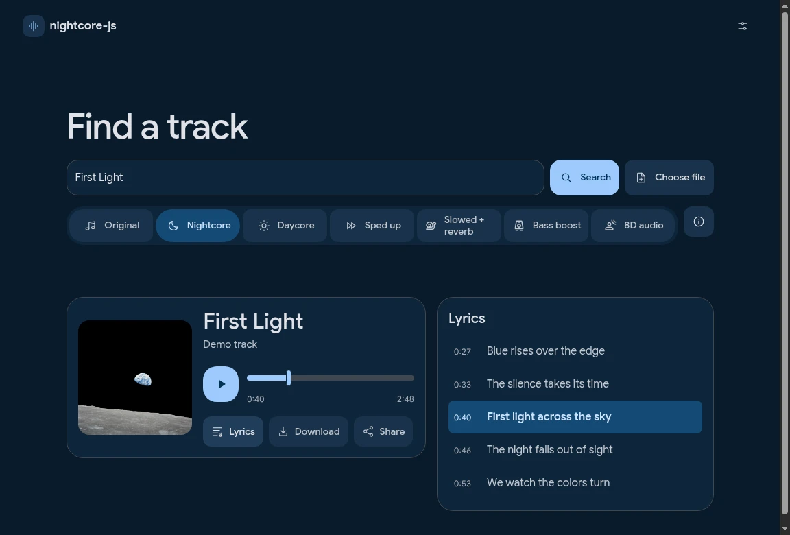

# nightcore-js

**Search for a song, change how it sounds, and follow the lyrics as it plays.**

Start with a YouTube link, a song name, or an audio file. Switch effects while listening, jump to a line in the lyrics, or save the version you like.

[Quick start](#quick-start-with-docker) · [Deploy with Nginx](#deploy-behind-nginx) · [Development](#local-development) · [Credits](#credits)



## What you can do

| Feature | How it works |
| --- | --- |
| Audio effects | Choose Nightcore for higher pitch and faster playback, Daycore for lower pitch and slower playback, or try Sped up, Slowed + reverb, Bass boost, and 8D audio |
| Original and downloads | **Original** plays and downloads the source in its stored format without re-encoding. **Download** saves the loaded version. Effects export as MP3 |
| Synchronized lyrics | Follow the highlighted line and select a timestamped line to jump there. Availability depends on the recording and provider |
| Your own files | Upload MP3, WAV, M4A, FLAC, or Ogg up to 50 MB and 10 minutes. Files stay private to your browser session for 24 hours |
| Share | A hosted player shares the YouTube track and selected mode. On localhost, Share uses the public YouTube link when available. Private uploads can be shared as files on compatible devices |
| Appearance | The cover supplies the palette. Choose System, Light, or Dark independently of the effect |

## Quick start with Docker

Install [Docker with the Compose plugin](https://docs.docker.com/compose/install/) and open a checkout that contains this README. From the project directory, run:

```sh
docker compose up -d --build --wait
```

Open **http://localhost:3001**. Compose builds and serves the player and API together, with FFmpeg, ffprobe, and yt-dlp included. The named `tracks` volume keeps the cache across restarts. Use `docker compose logs -f nightcore` to see application logs.

## Deploy behind Nginx

This example uses Docker Compose and Nginx on the **same server**. Point your domain's DNS at the server, allow inbound TCP 80 and 443, and replace `music.example.com` everywhere below. Compose binds the app to `127.0.0.1:3001`, so Nginx can reach it locally.

1. Open the project directory. Set this in the project root `.env` and start the container from that directory.

   ```dotenv
   PUBLIC_ORIGIN=https://music.example.com
   ```

   ```sh
   docker compose up -d --build --wait
   curl -fsS http://127.0.0.1:3001/api/health
   ```

2. Add the following server block to Nginx. On Debian or Ubuntu, save it as `/etc/nginx/sites-available/nightcore-js` and enable it with the commands below.

   ```nginx
   server {
       listen 80;
       listen [::]:80;
       server_name music.example.com;

       client_max_body_size 55m;

       location / {
           proxy_pass http://127.0.0.1:3001;
           proxy_http_version 1.1;
           proxy_set_header Host $http_host;
           proxy_set_header X-Forwarded-For $proxy_add_x_forwarded_for;
           proxy_set_header X-Forwarded-Proto $scheme;
           proxy_request_buffering off;
           proxy_read_timeout 300s;
           proxy_cache off;
       }
   }
   ```

   ```sh
   sudo ln -s /etc/nginx/sites-available/nightcore-js /etc/nginx/sites-enabled/nightcore-js
   sudo nginx -t
   sudo systemctl reload nginx
   ```

3. Install [Certbot with its Nginx plugin](https://certbot.eff.org/instructions), then issue a certificate and redirect HTTP to HTTPS.

   ```sh
   sudo certbot --nginx --redirect -d music.example.com
   curl -fsS https://music.example.com/api/health
   ```

The health endpoint returns `{"status":"ok"}`. Set `PUBLIC_ORIGIN` to the exact public HTTPS origin, with no trailing slash. The backend uses it to accept same-origin uploads through the proxy and set secure session cookies. The proxy body limit leaves room for multipart uploads, and the read timeout gives the backend time to render audio. [Nginx proxy documentation](https://nginx.org/en/docs/http/ngx_http_proxy_module.html)

A hosted instance uses anonymous YouTube access. YouTube can reject individual videos or requests from a server IP. Check the Compose logs if that happens. File uploads provide a separate source for playback.

## Local development

Install Node 24+, pnpm, FFmpeg and ffprobe, plus yt-dlp 2026.11.23 or newer with bundled EJS or the `yt-dlp[default]` package. Put the executables on PATH or set their paths in `backend/.env` using [the example](backend/.env.example).

In separate terminals, from the project root:

```sh
cd backend
pnpm install --frozen-lockfile
pnpm dev
```

```sh
cd frontend
pnpm install --frozen-lockfile
pnpm dev
```

Open the Vite URL printed in the terminal. Vite proxies API requests to `127.0.0.1:3001`. If you change the backend port, pass the matching `VITE_API_TARGET` when starting Vite.

Run `pnpm test` in the backend with FFmpeg and ffprobe installed. Run `pnpm lint` and `pnpm build` in the frontend.

<details>
<summary>Optional local YouTube session</summary>

YouTube cookies can grant access to your account. Sharing them can give someone else that access. Enable this only on a machine you control.

For a native backend bound to loopback, copy `backend/.env.example` to `backend/.env`. Set `YT_DLP_LOCAL_AUTH=1` and `YT_DLP_COOKIES_FROM_BROWSER=firefox` or the yt-dlp browser specification for your profile, then restart. If you already have a private Netscape cookie file, you can set `YT_DLP_COOKIES_PATH` instead. Keep that file outside the project and restrict access to it.

Authenticated tracks use a separate local cache. See [yt-dlp's cookie guidance](https://github.com/yt-dlp/yt-dlp/wiki/FAQ).

</details>

## Credits

- **Audio** · [yt-dlp](https://github.com/yt-dlp/yt-dlp) retrieves YouTube audio, and [FFmpeg](https://ffmpeg.org/) applies effects and encodes MP3.
- **Lyrics, track data, and covers** · [LRCLIB](https://lrclib.net/docs), [MusicBrainz](https://musicbrainz.org/), [Cover Art Archive](https://coverartarchive.org/), and the [iTunes Search API](https://developer.apple.com/library/archive/documentation/AudioVideo/Conceptual/iTuneSearchAPI/).
- **Interface** · [Material 3 Expressive](https://m3.material.io/), the [`material` web loading indicator](https://md3.io/docs/components/loading-indicator/), [Material Color Utilities](https://github.com/material-foundation/material-color-utilities) for cover palettes, and [Material Symbols](https://github.com/google/material-design-icons) for effect icons.
- **Preview** · Demo audio and lyrics with the Apollo 8 [Earthrise photograph](https://eol.jsc.nasa.gov/scripts/sseop/photo.pl?frame=2383&mission=AS08&roll=14) by NASA.
